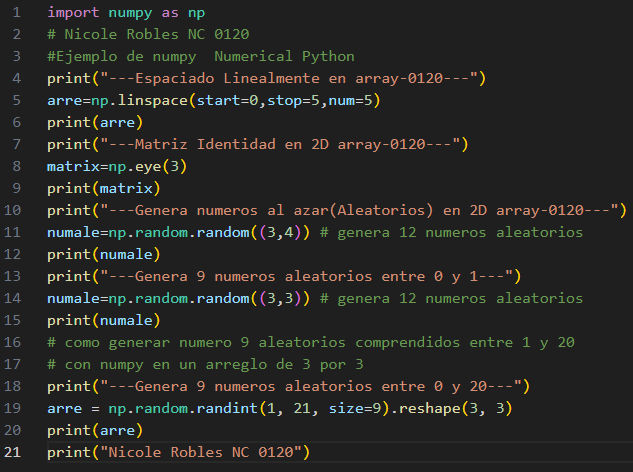
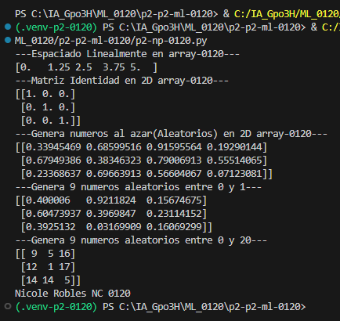

- `start=0`: Indica el valor inicial de la secuencia.
- `stop=1`: Indica el valor final de la secuencia.
- `num=5`: Indica la cantidad de valores que se generarán.

## Que es np.linespace?
- `np.linspace` es una función de NumPy que genera una cantidad determinada de números distribuidos uniformemente entre un valor inicial y uno final.

## Codigo

## Resultado
